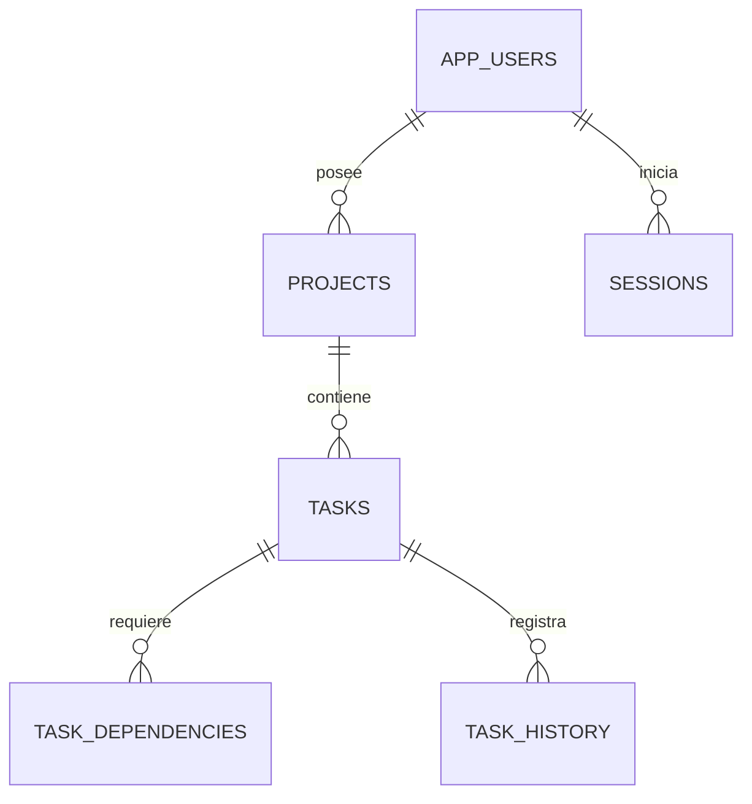

# TechTask — Sistema de gestión de proyectos técnicos y entregas escolares

## 1. Portada

**Proyecto Final de los Módulos 4 y 5 — Generación T, Streambe**  
Estudiante: Agustín Manteiga  
Institución: Escuela Técnica N.º 35 «Ing. Eduardo Latzina»  
Especialidad: Computación · Sexto año  
Materia: Prácticas Profesionalizantes · Ciclo lectivo 2026  
Modalidad: trabajo individual · Fecha del registro: 16/11/2026

Documento Markdown preparado para exportación a PDF. Los estados de publicación y pruebas están respaldados por los registros reales de esta entrega.

## 2. Introducción

TechTask organiza tareas de proyectos escolares y técnicos con fechas, materias y requisitos previos. El Proyecto Final evoluciona una implementación local del TP4 hacia una aplicación con cuentas privadas y reglas que impiden operaciones inconsistentes.

## 3. Problema y justificación

Una entrega puede depender de completar otras actividades. Un ABM plano permite marcarla como finalizada aunque sus requisitos sigan pendientes. La aplicación agrega un grafo de dependencias, validación transaccional e historial para que las decisiones del dominio se hagan explícitas y verificables.

## 4. Objetivos

Implementar gestión privada, preservar integridad de dependencias/estados, mostrar progreso y alertas derivadas, mantener persistencia real y construir una entrega reproducible con GitHub, pruebas y aplicación alojada. No se mide éxito por cantidad de código generado.

## 5. Alcance

Registro/login/logout; proyectos propios; CRUD de tareas con bajas permitidas; fechas, prioridades, materias, favoritas; filtros/búsqueda; dependencias sin ciclos; entrega protegida; historial; progreso; urgencia 7/3; advertencia de acumulación. Sin colaboración entre cuentas, roles docentes, adjuntos, chat, recuperación de contraseña ni IA dentro del producto.

## 6. Metodología AI-First

Se utilizó análisis previo y aprobación humana. El usuario aprobó totalmente el análisis y eligió cuentas privadas, autorizando ejecución autónoma. La propuesta técnica no se atribuye como reflexión personal del estudiante. Los documentos definen contexto y límites; los agentes implementan sobre criterios y los tests contrastan resultados.

El ciclo seguido es especificación→prueba roja cuando corresponde→implementación→prueba verde→revisión→corrección/refactor→commit. Se conservaron tanto fallos reales como resultados exitosos, sin crear una historia retrospectiva artificial.

## 7. Relevamiento y análisis

GitHub estaba vacío; localmente existía el TP4 sin commits ni remoto. El primer commit preserva ese trabajo con su fecha real de registro. El TP4 contaba con React/Vite/TypeScript, Express Controller/Service/Repository, SQLite y GET/POST de tareas. Se ejecutaron sus 28 pruebas antes de modificar. Los informes anteriores se conservaron en docs/entrega-tp4.

La auditoría detectó dos errores no cubiertos: longitud Unicode divergente entre JavaScript y SQLite, y una clave desconocida especial no rechazada por el recolector de errores. También identificó selección ambigua de formulario y aviso de éxito persistente tras un fallo. El diagnóstico A–D está en auditoria-inicial.md.

## 8. Reglas de negocio

La SPEC define RN01–12 con datos, validaciones, responsables y límites. Las más importantes son dependencias del mismo proyecto, prohibición de ciclos, entrega solo desde desarrollo con requisitos entregados, protección de reapertura, baja restringida y control de versiones. Urgencia, progreso y conflictos se calculan a partir de datos persistidos, sin porcentajes duplicados.

La regla histórica TP4 de tres días se reemplaza explícitamente por niveles 7/3 aprobados. Materia sigue siendo texto validado, no catálogo oficial. Los textos se cuentan por puntos Unicode y se rechaza U+0000 antes de PostgreSQL.

## 9. Historias de usuario

HU01–12 están expresadas Dado/Cuando/Entonces en spec.md y relacionadas con sus RN. Los recorridos incluyen cuenta privada, proyecto, alta/edición de tarea, grafo, rechazo de entrega, resolución y progreso, conservación tras recarga y aislamiento entre usuarios.

## 10. Arquitectura

Frontend→HTTP→Express→Controller→Service→Repository→PostgreSQL. React no ejecuta SQL; sus componentes presentan e interactúan, hooks coordinan estado y el cliente HTTP normaliza errores. Controller interpreta HTTP, Service aplica reglas y Repository ejecuta SQL parametrizado. Middleware centraliza sesión, origen, límites y errores.

Este diseño permite mantener las responsabilidades del TP4 sin incorporar ORM, microservicios o patrones de inyección innecesarios.

## 11. Modelo de base de datos

UUIDs como claves, FKs, unicidad de email y par de dependencia, CHECK de enums/límites e índices por propietario/proyecto y dependencia inversa. La migración inicial se versiona y se protege con bloqueo transaccional. Las bajas lógicas conservan trazabilidad y se excluyen de cálculos activos.

PostgreSQL es el motor productivo. PGlite ejecuta PostgreSQL embebido para desarrollo local; no es un mock ni una validación del servicio alojado. Por eso se agregaron pruebas contra PostgreSQL de servidor y un workflow con PostgreSQL 16.

## 12. Equipo de agentes

Analista, Arquitecto y Revisor trabajaron inicialmente solo lectura. Backend y Frontend implementaron carpetas asignadas; Tester escribió especificaciones y verificó resultados. Root coordinó contratos, documentación, integración, commits y publicación. Los perfiles están en docs/agentes; la equivalencia con Codex está explicada en AGENTS.md.

No se afirma que los seis roles ejecutaron simultáneamente. La plataforma permite tres subagentes más root en paralelo y se activaron por etapas.

## 13. Planificación

plan.md describe arquitectura, persistencia, contratos, riesgos y despliegue. tasks.md organiza T01–15 con dependencias, RN/HU, criterio de terminado, pruebas y estado. La matriz de cumplimiento utiliza exclusivamente los estados de la consigna.

## 14. Justificación del orden

Autenticación y propietario preceden CRUD porque afectan todas las consultas. El modelo y las migraciones preceden pantallas para evitar contratos cambiantes. Dependencias, ciclos y atomicidad se implementan antes de ampliar detalles visuales: son los riesgos centrales del negocio. Evidencias y publicación se verifican sobre el código integrado, no sobre pantallas simuladas.

## 15. Implementación

El backend aplica propiedad en consultas y mutaciones. Para operaciones críticas bloquea el proyecto con FOR UPDATE, vuelve a leer el estado, comprueba versión y valida el grafo dentro de la transacción. El historial se inserta con el cambio de estado. Un fallo revierte ambos.

El frontend maneja carga/vacíos/errores, conserva selección de proyecto en URL y renueva datos tras mutaciones. Un 409 informa conflicto y actualiza la versión, sin sobrescribir silenciosamente. Login/logout desmontan las vistas privadas.

El importador abre SQLite en solo lectura, exporta un respaldo y autentica una cuenta destino. Inserta un proyecto legado transaccional, conservando IDs/fechas/estados. No inventa historial para estados importados. Duplicaciones revierten la importación completa.

## 16. Pruebas

La batería final local contiene 59 pruebas: reglas y HTTP, calendario, concurrencia, fallos e importación. El e2e de Edge recorre registro→proyecto→tareas→dependencia→rechazo409→resolución→entrega→historial/progreso→recarga→móvil→logout→segunda cuenta. Los logs originales están en docs/evidencias y el detalle requisito/datos/resultado en informe-pruebas.md.

Los tests TP4 incompatibles con cuentas privadas se preservaron en tests/legacy como antecedentes. No se hicieron pasar debilitando seguridad para conservar el contrato anónimo anterior.

## 17. Resultados

TypeScript y compilación pasaron tras integración. Las 59 pruebas locales y el e2e pasaron. Se registran por separado la batería remota, CI y el despliegue en los documentos de publicación y pruebas; no deben deducirse a partir del resultado local.

## 18. Seguridad

Contraseñas con scrypt y salt aleatorio, tokens de sesión opacos almacenados por hash y cookies HttpOnly/SameSite=Lax/Secure en producción. Expiración y revocación al logout. Orígenes exactos, JSON obligatorio, límite 128KB compatible con textos Unicode del contrato, cabeceras Helmet y límites de intentos/API. Sin stack/SQL al cliente ni secretos en bundles.

Las cuentas no cuentan con recuperación o verificación de correo: limitación explícita para uso académico. CORS no reemplaza autenticación. El servicio no se presenta como un sistema institucional auditado para información sensible.

## 19. Publicación

GitHub oficial conserva commits reales. Render se prepara para servir React y Express bajo el mismo origen; Neon almacena PostgreSQL. La conexión se transmite únicamente al entorno secreto del servidor, nunca a GitHub. Autorización explícita adicional del usuario registró destino Render y credencial Neon, tras un rechazo de revisión automática. Ver docs/publicacion.md para URLs y verificación real.

## 20. Dificultades encontradas

- Entorno restringido impedía ciertas ejecuciones; se solicitaron permisos de ejecución cuando correspondía.
- La integración Neon devolvía Unknown tool; el usuario la reconectó y luego funcionó.
- La revisión automática bloqueó pruebas remotas con destino insuficientemente delimitado; se creó techtask_test y el ejecutor prohíbe otros nombres.
- La terminal Windows convirtió el terminador de stdin; se adaptó a CR/LF sin imprimir credenciales.
- Un test esperaba 200 de health con la base cerrada; la expectativa correcta es 500 controlado. Se corrigió el test, no la producción para satisfacer una expectativa errónea.
- Selectores exactos de navegador incluían textos auxiliares; se corrigieron usando rol y nombre accesible apropiados.

## 21. Decisiones técnicas

decisiones.md conserva pregunta, alternativas, fundamento y consecuencias. Se eligieron cuentas privadas por instrucción humana explícita; PostgreSQL por persistencia externa; sesiones simples frente a tokens en navegador; versiones más transacciones para integridad; dominio acotado frente a funciones superficiales. El límite de body se elevó a 128KB para aceptar los 10000 puntos Unicode máximos de descripción.

## 22. Conclusiones

La evolución muestra que separar capas permite incorporar propiedad, reglas de grafo y persistencia sin trasladar SQL a la interfaz. La revisión independiente encontró casos que los tests iniciales no contemplaban; corregirlos con nuevas regresiones aportó más valor que aumentar código sin evidencia.

Estas son conclusiones técnicas del proceso asistido. La valoración personal del estudiante no se redacta en su nombre y puede agregarse luego de su propia revisión.

## 23. Enlaces

Repositorio: https://github.com/feghi0/TechTask  
CI: https://github.com/feghi0/TechTask/actions  
Aplicación/backend: consultar docs/publicacion.md; solo se marcará verificado después de probar la URL real.

## 24. Anexos y evidencias

SPEC, decisiones, plan, tareas, perfiles de agentes, auditoría inicial, informe de pruebas, matriz, guía de presentación, capturas reales y registros. El concepto generado del TP4 está rotulado como diseño; no se reutiliza como prueba de la aplicación final.
