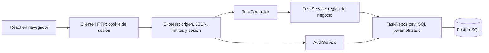

# Manual técnico y de desarrollo

## Arquitectura en ejecución

El servidor usa `pg` con Pool para PostgreSQL externo o PGlite para local/pruebas, con un único dialecto SQL. No se utiliza ORM, JWT en navegador ni consultas SQL en React.

## Mapa de módulos

| Ruta | Responsabilidad |
|---|---|
| `frontend/src/main.tsx` | Montaje de React y estilos. |
| `frontend/src/App.tsx` | Restaurar sesión, navegación, logout y selección de proyecto en hash. |
| `frontend/src/services/api.ts` | Fetch con credenciales, tipos de respuesta, errores y evento de expiración. |
| `frontend/src/components/AuthScreen.tsx` | Login/registro y mínimo de contraseña vigente. |
| `ProjectList`, `ProjectForm` | Listado y formulario de proyectos. |
| `ProjectWorkspace` | Cargar detalle, filtros, mutaciones y actualización tras conflictos. |
| `TaskForm`, `TaskCard`, `TaskInspector`, `Modal` | Formularios, tarjetas, estados/dependencias/historial y diálogo accesible. |
| `backend/src/server.ts` | Variables, producción, bind y cierre por señales. |
| `backend/src/app.ts` | Composición, middleware, rutas, estáticos y errores. |
| `backend/src/controllers/task-controller.ts` | Traducir parámetros/cuerpos y códigos HTTP. |
| `backend/src/services/task-service.ts` | Propiedad, validación, versiones y reglas de proyectos/tareas. |
| `auth-service.ts`, `validation.ts`, `calendar.ts` | Credenciales/sesiones; validadores; urgencia y conflictos. |
| `backend/src/repositories/task-repository.ts` | Consultas y mapeo SQL↔contratos. |
| `backend/src/database/db.ts`, `migrations.ts` | Adaptador y esquema versionado. |
| `shared/contracts.ts` | Contratos vigentes de usuario, proyecto, tarea y cálculos. |

Los archivos `shared/task.ts`, `frontend/src/hooks/useTasks.ts`, `services/tasks.ts` y `utils/dates.ts` proceden del TP 4. La aplicación actual no utiliza ese hook/cliente antiguo ni su urgencia de tres días; conservarlos no significa que sean otra fuente de verdad. No basar funciones nuevas en ellos. Revisar sus referencias antes de una futura limpieza.

## Flujo: entregar una tarea

1. La UI envía PATCH de estado con la versión leída.
2. Middleware comprueba sesión y origen; Controller obtiene el propietario de la sesión, nunca del body.
3. Service valida UUID y claves permitidas.
4. Inicia una transacción, localiza la tarea propia y bloquea la fila de su proyecto con FOR UPDATE.
5. Vuelve a leer tarea y versión; rechaza versión obsoleta.
6. Comprueba transición y requisitos entregados.
7. Repository actualiza estado/versión e inserta historial en la misma transacción.
8. Commit y respuesta con tarea actualizada. La UI vuelve a consultar el proyecto y actualiza progreso.

Un rechazo produce rollback. No se registra una entrega fallida como si hubiera ocurrido. El bloqueo de proyecto se comparte entre cambios de estado, dependencias, bajas y alta de tareas para serializar decisiones críticas del mismo grafo.

## Contratos y límites

Los textos del dominio usan trim y puntos de código Unicode, con rechazo de NUL. La contraseña usa la longitud de string de JavaScript, coherente con el control HTML; su mínimo es 4 y máximo 128. Fechas de entrega son YYYY-MM-DD sin hora; los timestamps son UTC. No reemplazar dueDate por un timestamp convertido automáticamente a zona local.

No agregar claves extra al body ni enviar IDs, propietario, createdAt o status al alta de tarea. Para PATCH, enviar una versión entera positiva y al menos un campo editable. El número aumenta al mutar; no usarlo como fecha ni como contador de tareas del proyecto.

## Extender sin romper arquitectura

1. Registrar la decisión y actualizar SPEC/criterios antes de implementar.
2. Diseñar contrato en shared y validación en Service.
3. Preparar tests que expresen comportamiento y verificar rojo cuando corresponde.
4. Incorporar migración nueva si cambia esquema; no editar una migración aplicada como mecanismo de actualización.
5. Escribir SQL parametrizado en Repository y mantener ownership en todas las rutas.
6. Construir interfaz que explique errores reales; probar red lenta y versión obsoleta.
7. Ejecutar types, tests, build y verificación de navegador apropiada.
8. Actualizar manual/API/evidencia, revisar diff y hacer commit por tarea.

No hay transacciones anidadas soportadas por el adaptador; se rechazan explícitamente. Pasar el repositorio transaccional a todo el trabajo que deba compartir commit/rollback.

## Git y revisión

Consultar AGENTS.md. `main` es la rama oficial; para trabajo nuevo usar una rama `codex/...` cuando sea útil. No usar force push ni inventar commits. `npm run format:check` verifica Prettier; `npm run typecheck` no emite JavaScript. Las dependencias y bases no se versionan.

El autor del cambio debe identificar RN/HU, pruebas, efectos de migración y limitaciones. El revisor contrasta con SPEC, no con una descripción de intención. Un agente de revisión es solo lectura y no debe corregir código silenciosamente para aprobar su propia evaluación.
