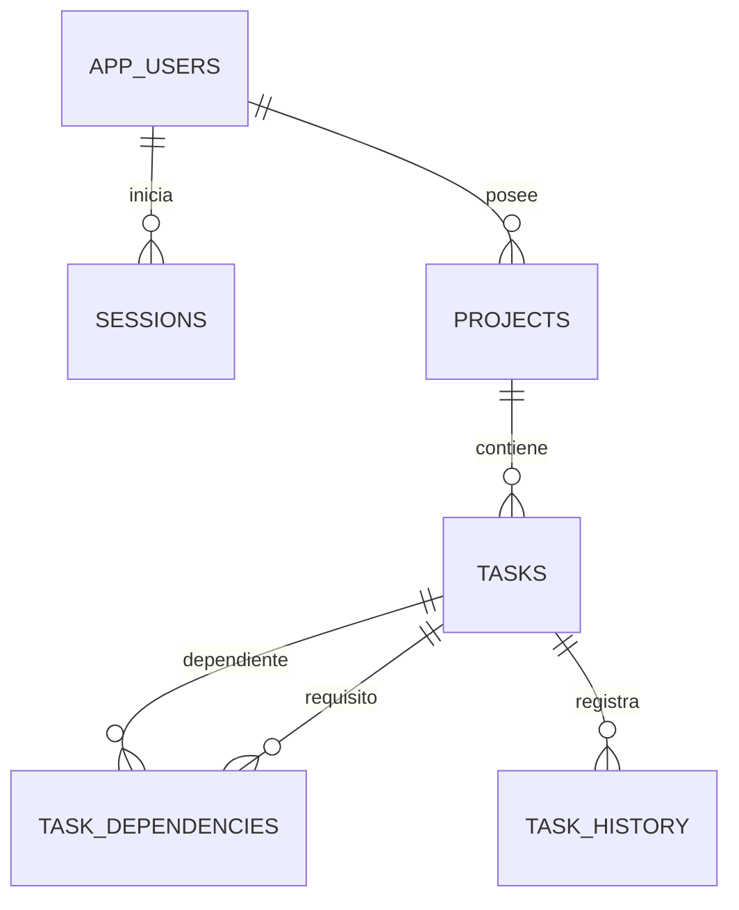

# Manual de base de datos y diccionario

Fuente de esquema: `backend/src/database/migrations.ts`. PostgreSQL 16 en despliegue y CI; PGlite local ejecuta SQL PostgreSQL. SQLite pertenece al TP 4 y se utiliza solo para lectura de legado/importación.

## Relaciones

`schema_migrations` registra versión y fecha de aplicación y no tiene relación funcional con una cuenta.

## Diccionario

| Tabla | Columna / tipo | Restricción y sentido |
|---|---|---|
| app_users | id UUID | PK generada por servidor. |
| | email TEXT | NOT NULL, UNIQUE; normalización en Service. |
| | password_hash TEXT | NOT NULL; formato salt:derivación scrypt. No contraseña reversible. |
| | created_at TIMESTAMPTZ | NOT NULL, CURRENT_TIMESTAMP. |
| sessions | token_hash TEXT | PK; SHA-256 del token opaco. |
| | user_id UUID | NOT NULL, FK a app_users, ON DELETE CASCADE. |
| | expires_at TIMESTAMPTZ | NOT NULL; siete días desde creación en la consulta de sesión. |
| projects | id UUID | PK. |
| | owner_id UUID | NOT NULL, FK a app_users; propietario. |
| | name TEXT | NOT NULL; CHECK char_length entre 3 y 80. |
| | description TEXT | NOT NULL, default vacío; límite 4000 en Service. |
| | version INTEGER | NOT NULL, default 1, CHECK >0. |
| | created_at TIMESTAMPTZ | NOT NULL, CURRENT_TIMESTAMP. |
| | deleted_at TIMESTAMPTZ | Nullable; baja lógica. |
| tasks | id UUID | PK. |
| | project_id UUID | NOT NULL, FK a projects. |
| | title TEXT | NOT NULL; CHECK char_length entre 3 y 60. |
| | description TEXT | NOT NULL, default vacío; límite 10000 en Service. |
| | subject TEXT | NOT NULL; CHECK de longitud de trim entre 1 y 100. |
| | status TEXT | NOT NULL, default pending; CHECK de los cuatro estados. |
| | priority TEXT | NOT NULL, default medium; CHECK low/medium/high. |
| | is_favorite BOOLEAN | NOT NULL, default false. |
| | due_date DATE | Nullable; fecha sin hora. |
| | version INTEGER | NOT NULL, default 1, CHECK >0. |
| | created_at TIMESTAMPTZ | NOT NULL, CURRENT_TIMESTAMP. |
| | deleted_at TIMESTAMPTZ | Nullable; baja lógica. |
| task_dependencies | task_id UUID | FK a tasks, parte de PK compuesta; tarea dependiente. |
| | dependency_id UUID | FK a tasks, parte de PK; requisito. CHECK task_id<>dependency_id. |
| task_history | id UUID | PK. |
| | task_id UUID | NOT NULL, FK a tasks. |
| | from_status / to_status TEXT | NOT NULL, CHECK de enums de estados. |
| | created_at TIMESTAMPTZ | NOT NULL, CURRENT_TIMESTAMP. |
| schema_migrations | version INTEGER | PK; actualmente versión 1. |
| | applied_at TIMESTAMPTZ | NOT NULL, CURRENT_TIMESTAMP. |

Las FKs sin cláusula de cascada no se convierten en borrados masivos por usar la aplicación. El flujo normal no elimina físicamente projects/tasks. No hay tabla subjects ni tabla de progreso.

## Qué impone cada capa

La base impone PK/FK, enums, unicidad de email y dependencia, autorreferencia y algunos límites. **No** garantiza por sí sola ausencia de ciclos, pertenencia de dos tareas al mismo proyecto, política de propietario o todas las transiciones: estas reglas viven en Service bajo transacción. Insertar SQL manualmente saltándose la API puede romper reglas aunque no falle una FK.

El Service normaliza trim, valida NUL, longitudes, fecha, versión, claves permitidas y contexto del dueño. El Repository filtra owner_id y bajas y utiliza parámetros. El frontend no sustituye esas restricciones.

## Índices

Además de PK/UNIQUE: sessions_expiry; projects_owner; tasks_project_active (índice parcial, deleted_at IS NULL); dependencies_reverse; history_task_date. Ayudan a expiración, listados, requisitos entrantes e historial. No se agregaron índices de texto completo ni se acreditó rendimiento para grandes volúmenes.

## Datos derivados y mapeo

JSON usa camelCase; SQL usa snake_case. No hay columnas `percentage`, `urgency`, `dependencyIds` ni `conflicts`: se obtienen al consultar. `projectDetail` calcula porcentaje entero con Math.round; el calendario usa Buenos Aires. Las fechas de creación/historial se devuelven como ISO UTC. `due_date` se proyecta como texto YYYY-MM-DD para evitar desplazamientos de día por zona horaria.

## Transacciones y concurrencia

Las mutaciones críticas bloquean la fila del proyecto con FOR UPDATE, vuelven a leer la tarea y comparan version. El grafo se examina con consulta recursiva para impedir ciclos; agregar vínculo e incrementar versión es atómico. Estado e historial comparten transacción. No se soportan transacciones anidadas en el adaptador.

La serialización de proyectos no implica un bloqueo global entre todos los usuarios. La lectura de listados no promete un snapshot histórico entre varias peticiones. Las pruebas de carreras cubren operaciones seleccionadas, no una certificación completa de aislamiento de cualquier futura consulta.

## Migraciones

Al crear la app se abre la base y se ejecuta migrate. Usa transacción y `pg_advisory_xact_lock(723416)` para coordinación. Si existe versión 1, no se vuelve a aplicar. Para un cambio futuro: agregar versión nueva, migración compatible, respaldo, prueba en base aislada y despliegue controlado. Editar el CREATE de versión 1 no actualiza una base que ya lo aplicó.

No hay comando de rollback, down migrations ni interfaz para restaurar bajas. Esas funciones no se presumen a partir de que exista versionado.

## Almacenamiento y ciclo de vida

Local: directorio PGlite ignorado por Git, un proceso por directorio. Remoto: conexión externa secreta; el disco efímero de Render no almacena la base productiva. Las sesiones vencidas se eliminan al crear una sesión nueva, no mediante una tarea programada. No existe política automática de purga del historial, cuentas o bajas.

Consultar [respaldo y restauración](07-respaldo-restauracion.md) antes de intervenir datos. No compartir dumps: pueden contener correo, hashes y tareas privadas aunque no incluyan contraseñas en claro.
