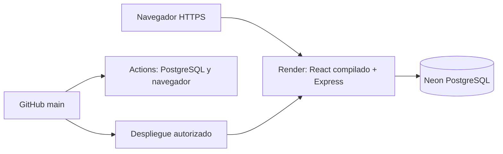

# Manual de operación y despliegue

Destinatario: responsable autorizado del repositorio y proveedores. No es una pantalla de administración de TechTask. Los comandos/procedimientos de este manual son instrucciones para futuras operaciones; no se ejecutaron sobre producción al escribirlos.

## Topología actual

URL: https://techtask-generacion-t.onrender.com. Health: `/api/health`. Servidor y frontend comparten origen; el navegador no se conecta directamente a Neon. Render puede exponer públicamente la app mientras sus datos requieren sesión privada.

La configuración reproducible está en render.yaml, pero el servicio existente se creó mediante API. No asumir que un campo del YAML esté aplicado al servicio actual. En particular, el registro de publicación indica comprobación TCP predeterminada del proveedor; `/api/health` se comprueba externamente. Consultar [publicación](../publicacion.md) para cronología y commit funcional vigente.

## Responsabilidades

Operador: configuración, secretos, respaldos, despliegue, incidentes. Desarrollador: cambio probado y migración compatible. Revisor: confirmar impacto. El usuario final no recibe acceso a base o dashboard del proveedor para usar la aplicación.

## Antes de desplegar

1. Identificar servicio, workspace, rama y commit exacto; revisar cambios y autorización.
2. Comprobar CI, tests, types y build del código elegido.
3. Si cambia datos/esquema, obtener respaldo y probar la migración en destino aislado.
4. Confirmar DATABASE_URL del backend, TLS, NODE_ENV=production, HOST=0.0.0.0 y PORT del proveedor.
5. Mantener una instancia coherente con el pool y presupuesto. No contratar planes pagos por inferencia.
6. Revisar cómo conviven versión anterior/nueva durante el despliegue y compatibilidad de migración.

Build: `npm ci --include=dev && npm run build`. Start: `npm start`. Node de referencia: 22.21.0. La instalación de herramientas de build es necesaria aunque el runtime sea producción.

## Desplegar y verificar

Primero inspeccionar deployments. No crear otro si ya existe uno pendiente para el commit. El servicio se creó desde una URL Git pública y en esta ejecución no siguió automáticamente los pushes, aunque apareciera autoDeploy=yes. Verificar el comportamiento efectivo en lugar de asumirlo. Si no hay automatismo, desplegar el commit autorizado por el mecanismo del proveedor.

Un estado build_in_progress/update_in_progress no equivale a servicio probado. Esperar live, comprobar commit y luego:

- Health200 y portada sin errores de carga.
- Registro/login con cuenta ficticia, creación y recarga.
- Rechazo de entrega con requisito pendiente y entrega posterior válida.
- Cookie Secure/HttpOnly/Lax; logout y sesión revocada.
- Segunda cuenta sin acceso al proyecto de la primera.
- Logs sin nuevos errores internos no explicados.

`scripts/check-public.mjs` y `scripts/check-password-minimum.mjs` generan cuentas ficticias y realizan escrituras. Solo ejecutarlos contra un destino autorizado. `TT_PUBLIC_URL` en e2e también realiza operaciones, no es un monitor de solo lectura.

## Supervisión rutinaria

Health consulta `SELECT 1`: un500 indica que el servicio no está listo para operar con la base. Revisar conectividad, credencial, TLS y estado del proveedor. No convertir health en una respuesta200 fija para ocultar el problema.

Consultar logs de aplicación, métricas del servicio y consumo de base. No guardar cookies, contraseñas, cuerpos de autenticación o URLs completas de conexión en tickets. Un401 inicial sin sesión y un409 esperado de negocio no son caídas del servidor. Registrar fecha/zona, commit, entorno, ruta, código y alcance del incidente.

Los límites por IP son 120 solicitudes/minuto en API y 30 intentos de registro/login por 15 minutos fuera de tests. Se almacenan en memoria del proceso, no en un sistema distribuido; varias personas tras una IP pueden compartir límite. No presentar esto como protección integral ante ataques.

## Secretos y rotación

Mantener DATABASE_URL solo en entorno privado del proveedor. Si se rota la credencial: coordinar nueva contraseña/rol, actualizar entorno del servicio, desplegar configuración vigente y probar conexión. Revocar credenciales antiguas según el proveedor y el plan aprobado. No imprimir la cadena para comprobar que está configurada.

Rotar no significa cambiar la clave de una cuenta de TechTask desde SQL. El producto no tiene recuperación/cambio de contraseña implementado. Ante un incidente de identidad, seguir el procedimiento autorizado del operador.

## Reversión y recuperación

Revertir código no revierte migraciones ni tareas creadas. Elegir un commit compatible con el esquema actual y comprobarlo; si se requiere restaurar datos, seguir el manual de respaldos como operación separada. No usar force push como mecanismo de rollback. No eliminar el servicio o la base para simular una reparación.

## Límites del entorno alojado

El plan gratuito puede suspenderse por inactividad y tiene cuotas. No hay SLA propio, monitor permanente ni backup cron del proyecto. Las capacidades vigentes de los proveedores deben consultarse antes de una operación: [Render](https://render.com/docs/free), [Neon](https://neon.com/docs/introduction/plans). No almacenar PostgreSQL productivo en el filesystem efímero del backend.
