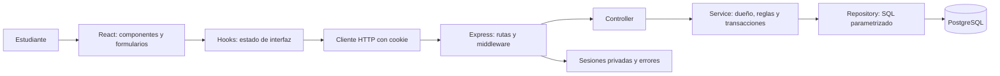

# Plan técnico

## Arquitectura

## Módulos y contratos

frontend/src: componentes de autenticación, proyectos, tareas, dependencias e historial; hooks de sesión/datos; servicio HTTP. backend/src: composición y servidor, controllers, services, repositories, database y middleware. shared/contracts.ts: tipos sin dependencias del servidor. tests: integración con PostgreSQL/PGlite y navegador. docs/evidencias: resultados actuales; docs/entrega-tp4: antecedentes intactos.

La API y los códigos se definen en spec.md. Las operaciones del dominio viven en Service y las consultas en Repository. Middleware valida sesión, origen, formato/tamaño y limita abuso. Sin ORM. Cookie de sesión no accesible desde JavaScript; hashes de contraseña/sesión nunca se serializan.

## Base de datos y migraciones

PostgreSQL como único dialecto. Local y pruebas usan PGlite (motor PostgreSQL WASM, persistente en directorio local), producción usa pg/Pool y DATABASE_URL. No se equipara la prueba embebida con una prueba de TCP/TLS o concurrencia de servidor. CI tendrá un servicio PostgreSQL real para ejecutar la misma batería cuando sea posible.

Tablas: users 1:N sessions y projects; projects 1:N tasks; tasks N:N tasks mediante task_dependencies; tasks 1:N task_history. UUID PK, FKs, emails únicos, par de dependencia único y sin autorreferencias, CHECK de enums y límites. Índices por propietario/proyecto y por dependencia entrante. Porcentaje y urgencia no se almacenan duplicados.

Migraciones versionadas e idempotencia controlada por tabla de versiones. No modificar SQLite original. El importador exige cuenta destino autenticada, lee SQLite en modo solo lectura, crea un proyecto de legado y verifica títulos/IDs/cantidad; documenta conflictos sin perder la fuente. Copia de respaldo antes de importación; nunca enlazar datos anónimos a cualquier usuario que registre.

## Consistencia

Version en objetos mutables: comparar revisión actual, incrementar al guardar, 409 si obsoleta. Bloquear la fila del proyecto dentro de transacción para cambios de grafo/estado/baja; revalidar requisitos bajo ese bloqueo. Escribir historial con el cambio de estado, no después. Rollback ante fallo. No usar solo un mutex de JavaScript para proteger múltiples instancias productivas.

## Entregas incrementales

1. Base histórica conservada, auditoría y documentación aprobada.
2. Regresiones Unicode/claves extra/selectores, esquema y cuenta privada.
3. Proyectos y CRUD de tareas aislados.
4. Dependencias, estados y entrega protegida; historial atómico.
5. Progreso, alertas 7/3, conflictos y UI completa.
6. Integración e2e, seguridad y revisión independiente.
7. Migración/seed, CI y producción.
8. Publicación comprobada, evidencias, informe y matriz.

La autenticación y el modelo se priorizan antes de agregar pantallas: ownership y claves foráneas afectan todas las consultas. Dependencias y transacciones preceden a adornos visuales porque contienen el riesgo principal de negocio.

## Pruebas

Tester deriva pruebas de HU/RN, captura rojo real cuando aplica y registra verde sin ocultar errores. Integración crea cuentas ficticias, proyectos y grafos. Reapertura de base real local verifica persistencia. Concurrencia requiere al menos dos solicitudes en paralelo y comprobar un resultado válido/rechazo sin inconsistencias. CI sobre PostgreSQL refuerza las pruebas locales. Playwright Edge o Chromium en CI ejecuta registro→proyecto→tareas→dependencias→entrega rechazada→resolución→historial/progreso→recarga→aislamiento y móvil.

## Despliegue

Preferir primer despliegue de React compilado servido por Express bajo un mismo origen en Render; Neon aloja PostgreSQL. Esto evita cookies cross-site frágiles. Soportar allowlist CORS explícita y frontend separado si se elige después. Netlify es alternativa para estáticos, no obligación arquitectónica. Producción debe rechazar configuración sin DATABASE_URL, usar puerto del proveedor, HTTPS/cookies Secure y secretos en entorno.

No iniciar servicios pagos sin permiso. Verificar planes vigentes antes de crear; Render gratuito tiene filesystem efímero y suspensión por inactividad (https://render.com/docs/free). Neon tiene cuotas y suspensión de cómputo (https://neon.com/docs/introduction/plans). Acceso a estas cuentas no está implícito en el acceso a GitHub.

Antes de publicar: build, tests, migraciones y allowlist correctos. Después: abrir URL real, registrar cuenta ficticia, probar grafo, validación, recarga, logout/aislamiento; verificar que bundles/logs no contienen credenciales. Guardar URLs retornadas por proveedores, nunca inventarlas.

## Riesgos y mitigación

| Riesgo | Mitigación |
|---|---|
| Cambio de esquema pierde TP4 | Origen SQLite intacto, respaldo e importación explícita. |
| Races permiten ciclos o reapertura inválida | Bloqueo por proyecto, transacción y pruebas paralelas. |
| Sesión expone datos entre cuentas | Filtro de propietario en cada consulta y pruebas de dos usuarios. |
| Hosting efímero borra DB | DATABASE_URL externa obligatoria en producción. |
| Robo/abuso de sesión | Hash de token en base, cookie HttpOnly/Secure, origen, límites y expiración. |
| Sin acceso externo | Completar local/CI/GitHub y marcar publicación bloqueada, sin fingir URL. |
| Validación local no representa Pool | Ejecutar CI en PostgreSQL y registrar diferencia. |
